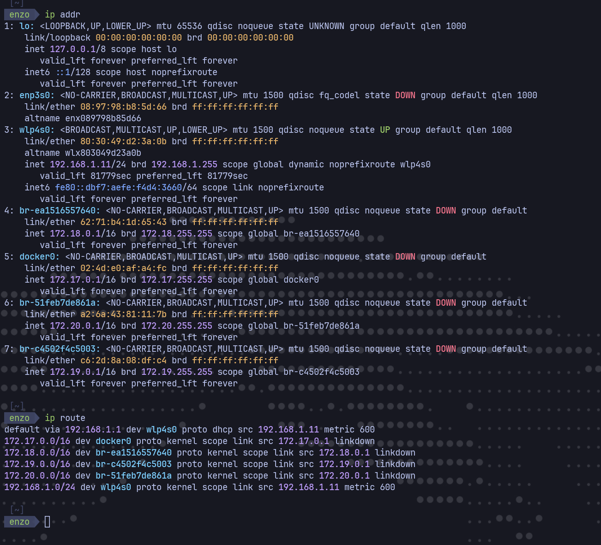
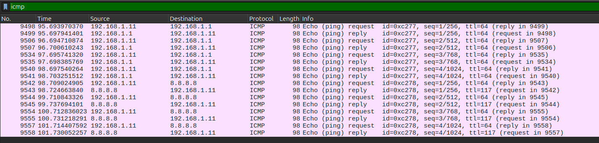

# Trabajo Práctico N°5

## Integrantes

- Enzo Nahuel Fernandez Mattio, 46225824, I.COMP
- Enzo Jesús Ferrando, 46320483, I.COMP
- Ignacio José Giraudo, 44900514, I.COMP
- Ezequiel Moreyra, 46226249, I.COMP

---

## Ejercicio 1: ICMP y primer contacto con Wireshark

#### 1.a)

ICMP es un protocolo que se usa para enviar mensajes de control y diagnóstico de la red, por ejemplo para avisar errores o comprobar si un equipo responde. No transporta los datos de una aplicación como TCP o UDP.

#### 1.b)

ICMP viaja dentro de un paquete IP. En IPv4, el campo `Protocol` vale `1` cuando el contenido es ICMP. A su vez, el paquete IP va dentro de una trama Ethernet.

#### 1.c)

`ping` envía mensajes ICMP **Echo Request** para comprobar si un destino responde. Si llegan, el destino contesta con **Echo Reply**. Se distinguen por el campo `Type`: `8` para Request y `0` para Reply.

#### 1.d)

Un mensaje Echo tiene, como mínimo, `Type`, `Code`, `Checksum`, `Identifier` y `Sequence Number`. Esos campos forman una cabecera de 8 bytes. También puede llevar datos o *payload*; en nuestro ping llevó 56 bytes.

---

### Configuración de red utilizada

Consultamos `ip addr` e `ip route` en Linux. La interfaz activa fue la Wi-Fi `wlp4s0`:

| Dato | Valor |
|---|---|
| Dirección IPv4 | `192.168.1.11` |
| Máscara | `/24` (`255.255.255.0`) |
| Gateway por defecto | `192.168.1.1` |
| MAC de `wlp4s0` | `80:30:49:d2:3a:0b` |



### Captura de los pings

Iniciamos una captura en `wlp4s0` y ejecutamos:

```bash
ping -4 -c 4 192.168.1.1
ping -4 -c 4 8.8.8.8
```

Después aplicamos el filtro de visualización `icmp`. En la captura aparecen cuatro Echo Request y cuatro Echo Reply para cada destino. Para verlos por separado sirven `icmp.type == 8`, `icmp.type == 0` e `icmp && ip.addr == 8.8.8.8`.



Para el análisis siguiente elegimos el Echo Request **n.º 9542** hacia `8.8.8.8` y su Echo Reply **n.º 9543**.

### Capas del Echo Request n.º 9542

| Capa | Origen o identificador | Destino | Campo que indica qué viene adentro |
|---|---|---|---|
| Ethernet II | MAC `80:30:49:d2:3a:0b` | MAC `e0:1f:ed:4f:52:f8` | `Type = 0x0800` indica IPv4. |
| Internet Protocol Version 4 | IP `192.168.1.11` | IP `8.8.8.8` | `Protocol = 1` indica ICMP. |
| Internet Control Message Protocol | Identificador `0xc278`, secuencia `1` | No tiene dirección de destino propia. | `Type = 8` indica Echo Request; no identifica otro protocolo interior. |
| Datos / payload | No tiene origen propio. | No tiene destino propio. | No hay otro protocolo; son datos del ping. |

#### Análisis de la captura

**a) MAC destino.** El Request a `8.8.8.8` salió hacia la MAC `e0:1f:ed:4f:52:f8`, que es la del gateway `192.168.1.1`. El ping al gateway usó esa misma MAC destino. La MAC sirve para llegar al siguiente equipo de la red local; la IP permite identificar el destino final, aunque esté fuera de nuestra red.

**b) Request y Reply.** Entre los paquetes 9542 y 9543 se invierten las MAC de origen y destino, y también las IP (`192.168.1.11` ↔ `8.8.8.8`). La MAC de origen del Reply es la del gateway, porque es el equipo que nos entrega esa trama en nuestra red. En ICMP cambia `Type` de `8` a `0` y cambia el checksum. En IP cambian el TTL, el identificador, el checksum y la marca `DF`, que solo aparece en el Request. Se mantienen `Type = 0x0800` en Ethernet, `Protocol = 1` y la longitud en IP, `Code = 0`, el identificador ICMP `0xc278`, la secuencia `1` y los datos. El identificador y la secuencia permiten asociar la respuesta con la solicitud correspondiente.

**c) Payload.** Está después de la cabecera ICMP. Tiene **56 bytes**: empieza con 16 bytes variables y sigue con el patrón hexadecimal `10 11 12 ... 37`. En el Reply esos 56 bytes volvieron iguales.

**d) TTL.** El Request salió con TTL **64** y el Reply de `8.8.8.8` llegó con TTL **117**. Son paquetes creados por equipos distintos y cada router reduce el TTL en uno durante el recorrido. Por eso no tienen por qué mostrar el mismo valor.

**e) Encapsulación.** Para el paquete n.º 9542, los tamaños observados fueron:

```text
Trama Ethernet: 98 bytes
└── Cabecera Ethernet II: 14 bytes
    └── Paquete IPv4: 84 bytes
        ├── Cabecera IPv4: 20 bytes
        └── Mensaje ICMP: 64 bytes
            ├── Cabecera Echo Request: 8 bytes
            └── Datos del ping: 56 bytes
```

La suma es `14 + 20 + 8 + 56 = 98` bytes, igual a la longitud que muestra Wireshark para esa trama.
