# Trabajo Práctico N°5

## Integrantes

- Enzo Nahuel Fernandez Mattio, 46225824, I.COMP
- Enzo Jesús Ferrando, 46320483, I.COMP
- Ignacio José Giraudo, 44900514, I.COMP
- Ezequiel Moreyra, 46226249, I.COMP

---

## Ejercicio 1: ICMP y primer contacto con Wireshark

#### 1.a)

ICMP es un protocolo que se usa para enviar mensajes de control y diagnóstico de la red, por ejemplo para avisar errores o comprobar si un equipo responde. No transporta los datos de una aplicación como TCP o UDP.

#### 1.b)

ICMP viaja dentro de un paquete IP. En IPv4, el campo `Protocol` vale `1` cuando el contenido es ICMP. A su vez, el paquete IP va dentro de una trama Ethernet.

#### 1.c)

`ping` envía mensajes ICMP **Echo Request** para comprobar si un destino responde. Si llegan, el destino contesta con **Echo Reply**. Se distinguen por el campo `Type`: `8` para Request y `0` para Reply.

#### 1.d)

Un mensaje Echo tiene, como mínimo, `Type`, `Code`, `Checksum`, `Identifier` y `Sequence Number`. Esos campos forman una cabecera de 8 bytes. También puede llevar datos o *payload*; en nuestro ping llevó 56 bytes.

---

### Configuración de red utilizada

Consultamos `ip addr` e `ip route` en Linux. La interfaz activa fue la Wi-Fi `wlp4s0`:

| Dato | Valor |
|---|---|
| Dirección IPv4 | `192.168.1.11` |
| Máscara | `/24` (`255.255.255.0`) |
| Gateway por defecto | `192.168.1.1` |
| MAC de `wlp4s0` | `80:30:49:d2:3a:0b` |


### Captura de los pings

Iniciamos una captura en `wlp4s0` y ejecutamos:

```bash
ping -4 -c 4 192.168.1.1
ping -4 -c 4 8.8.8.8
```

Después aplicamos el filtro de visualización `icmp`. En la captura aparecen cuatro Echo Request y cuatro Echo Reply para cada destino. Para verlos por separado sirven `icmp.type == 8`, `icmp.type == 0` e `icmp && ip.addr == 8.8.8.8`.


Para el análisis siguiente elegimos el Echo Request **n.º 9542** hacia `8.8.8.8` y su Echo Reply **n.º 9543**.

### Capas del Echo Request n.º 9542

| Capa | Origen o identificador | Destino | Campo que indica qué viene adentro |
|---|---|---|---|
| Ethernet II | MAC `80:30:49:d2:3a:0b` | MAC `e0:1f:ed:4f:52:f8` | `Type = 0x0800` indica IPv4. |
| Internet Protocol Version 4 | IP `192.168.1.11` | IP `8.8.8.8` | `Protocol = 1` indica ICMP. |
| Internet Control Message Protocol | Identificador `0xc278`, secuencia `1` | No tiene dirección de destino propia. | `Type = 8` indica Echo Request; no identifica otro protocolo interior. |
| Datos / payload | No tiene origen propio. | No tiene destino propio. | No hay otro protocolo; son datos del ping. |

#### Análisis de la captura

**a) MAC destino.** El Request a `8.8.8.8` salió hacia la MAC `e0:1f:ed:4f:52:f8`, que es la del gateway `192.168.1.1`. El ping al gateway usó esa misma MAC destino. La MAC sirve para llegar al siguiente equipo de la red local; la IP permite identificar el destino final, aunque esté fuera de nuestra red.

**b) Request y Reply.** Entre los paquetes 9542 y 9543 se invierten las MAC de origen y destino, y también las IP (`192.168.1.11` ↔ `8.8.8.8`). La MAC de origen del Reply es la del gateway, porque es el equipo que nos entrega esa trama en nuestra red. En ICMP cambia `Type` de `8` a `0` y cambia el checksum. En IP cambian el TTL, el identificador, el checksum y la marca `DF`, que solo aparece en el Request. Se mantienen `Type = 0x0800` en Ethernet, `Protocol = 1` y la longitud en IP, `Code = 0`, el identificador ICMP `0xc278`, la secuencia `1` y los datos. El identificador y la secuencia permiten asociar la respuesta con la solicitud correspondiente.

**c) Payload.** Está después de la cabecera ICMP. Tiene **56 bytes**: empieza con 16 bytes variables y sigue con el patrón hexadecimal `10 11 12 ... 37`. En el Reply esos 56 bytes volvieron iguales.

**d) TTL.** El Request salió con TTL **64** y el Reply de `8.8.8.8` llegó con TTL **117**. Son paquetes creados por equipos distintos y cada router reduce el TTL en uno durante el recorrido. Por eso no tienen por qué mostrar el mismo valor.

**e) Encapsulación.** Para el paquete n.º 9542, los tamaños observados fueron:

```text
Trama Ethernet: 98 bytes
└── Cabecera Ethernet II: 14 bytes
    └── Paquete IPv4: 84 bytes
        ├── Cabecera IPv4: 20 bytes
        └── Mensaje ICMP: 64 bytes
            ├── Cabecera Echo Request: 8 bytes
            └── Datos del ping: 56 bytes
```

La suma es `14 + 20 + 8 + 56 = 98` bytes, igual a la longitud que muestra Wireshark para esa trama.

---

## Ejercicio 2: ARP - De una IP a una dirección MAC

#### 2.a)

ARP (*Address Resolution Protocol*) resuelve el problema de traducir una dirección IP conocida en la dirección MAC correspondiente dentro de la misma red local. Cuando un equipo quiere enviar una trama Ethernet necesita saber la MAC del destinatario, pero generalmente solo conoce su IP; ARP es el mecanismo que permite hacer esa traducción. Su ubicación en el modelo de capas es discutible porque no encaja exactamente en ninguna capa: no viaja dentro de un paquete IP (no usa direccionamiento IP como payload de capa de red), pero tampoco es un protocolo puramente de capa de enlace, ya que trabaja justamente para vincular una dirección de capa 3 (IP) con una de capa 2 (MAC). Por eso suele ubicarse “entre” la capa 2 y la capa 3, o directamente considerarse un protocolo propio que no se ajusta del todo al modelo OSI clásico.

#### 2.b)

Un ARP Request es un mensaje que pregunta cuál es la MAC correspondiente en base a la IP de destino, que es conocida, y se envía a la dirección de broadcast de la red local (`ff:ff:ff:ff:ff:ff`), por lo que lo reciben todos los dispositivos conectados a la red porque el emisor no sabe a quién dirigirse específicamente ni conoce todavía la MAC del destinatario. Un ARP Reply es la respuesta que da el equipo que efectivamente tiene esa IP, informando su dirección MAC. A diferencia del Request, el Reply se envía de forma unicast, directamente a la MAC del equipo que preguntó, ya que ese dato sí es conocido (viene incluido en el propio Request).

#### 2.c)

La caché ARP es una tabla que cada equipo mantiene en memoria, asociando temporalmente direcciones IP con direcciones MAC que ya averiguó previamente. Existe para evitar tener que repetir el proceso de ARP Request/Reply cada vez que se necesita enviar una trama a un destino con el que ya se habló recientemente, ahorrando tráfico y tiempo en la red. Las entradas de la caché tienen un tiempo de vida limitado, pasado el cual expiran y deben volver a resolverse.

#### 2.d)

Si tengo la IP de una máquina de mi red local y necesito enviarle una trama, primero reviso mi caché ARP para ver si ya tengo guardada la MAC correspondiente a esa IP. Si la tengo, uso ese valor directamente. Si no la tengo, envío un ARP Request en broadcast a toda la red preguntando por esa IP; el equipo dueño de esa IP me responde con un ARP Reply indicando su MAC. Entonces guardo ese dato en mi caché y ya puedo armar la trama Ethernet con esa dirección de destino.

#### 2.e)

Ejecutamos `ip neigh show` y encontramos la entrada correspondiente al gateway:

```bash
enzo@enzo-HP-255R-15-6-inch-G10-Notebook-PC:~$ ip neigh show
192.168.1.1 dev wlo1 lladdr b4:3a:e2:89:e0:cf REACHABLE #corresponde al gateway
192.168.1.11 dev wlo1 lladdr 58:11:22:4d:7d:d4 STALE 
fe80::1 dev wlo1 lladdr b4:3a:e2:89:e0:cf router STALE 
```

Luego capturamos en Wireshark un ping al gateway (`ping -4 -c 4 192.168.1.1`) y seleccionamos el Echo Request, paquete n.º 80:

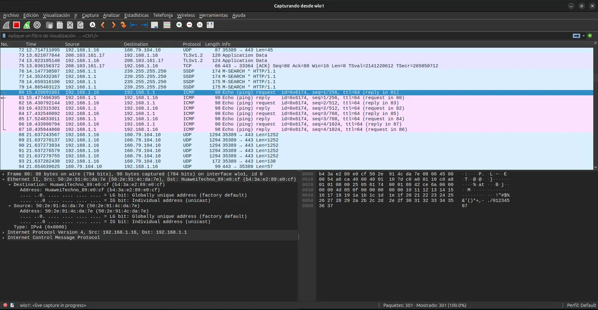

La MAC destino de esa trama Ethernet fue `b4:3a:e2:89:e0:cf`, identificada por Wireshark como `HuaweiTechno_89:e0:cf`. Esta dirección coincide exactamente con la que figura en la caché ARP para esa misma IP. El estado `REACHABLE` indica que la entrada ya estaba resuelta y validada antes de iniciar el ping, por lo que el sistema operativo la reutilizó directamente desde la caché en lugar de generar un nuevo ARP Request. Esto confirma que la caché ARP es la fuente de la que el sistema operativo obtiene la dirección MAC necesaria para armar la trama Ethernet, evitando así repetir el proceso de resolución en cada comunicación con un destino ya conocido.

#### 2.f)

Para forzar la generación de tráfico ARP (Opción B), eliminamos la entrada del gateway de la caché y volvimos a hacer ping:

```bash
enzo@enzo-HP-255R-15-6-inch-G10-Notebook-PC:~$ sudo ip neigh del 192.168.1.1 dev wlo1
ping -4 -c 2 192.168.1.1
[sudo] contraseña para enzo: 
PING 192.168.1.1 (192.168.1.1) 56(84) bytes of data.
64 bytes from 192.168.1.1: icmp_seq=1 ttl=64 time=3.14 ms
64 bytes from 192.168.1.1: icmp_seq=2 ttl=64 time=1.68 ms

--- 192.168.1.1 ping statistics ---
2 packets transmitted, 2 received, 0% packet loss, time 1001ms
rtt min/avg/max/mdev = 1.683/2.410/3.137/0.727 ms
```

Capturando en `wlo1` con el filtro `arp`, aparecieron los paquetes n.º 295 (ARP Request) y n.º 296 (ARP Reply), inmediatamente antes de los Echo Request/Reply del ping:

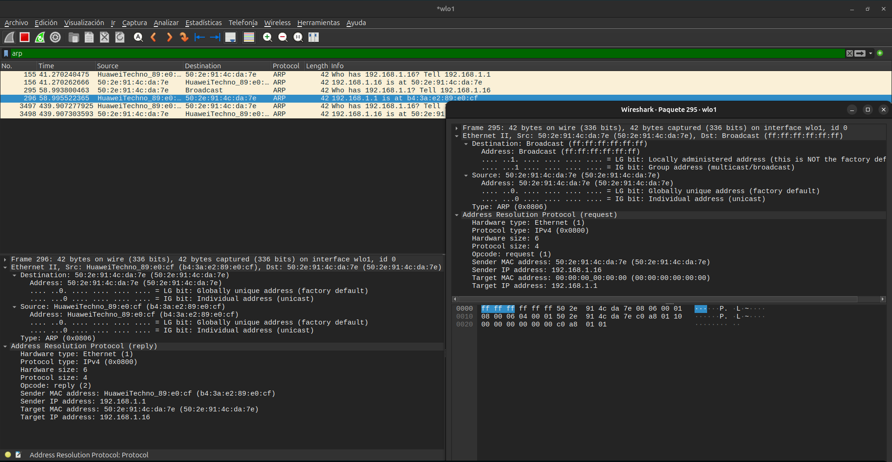

| Campo | ARP Request (295) | ARP Reply (296) |
| --- | --- | --- |
| MAC destino (Ethernet) | `ff:ff:ff:ff:ff:ff` (Broadcast) | `50:2e:91:4c:da:7e` |
| MAC origen (Ethernet) | `50:2e:91:4c:da:7e` | `b4:3a:e2:89:e0:cf` |
| Opcode | 1 (request) | 2 (reply) |
| Sender MAC address | `50:2e:91:4c:da:7e` | `b4:3a:e2:89:e0:cf` |
| Sender IP address | `192.168.1.16` | `192.168.1.1` |
| Target MAC address | `00:00:00:00:00:00` | `50:2e:91:4c:da:7e` |
| Target IP address | `192.168.1.1` | `192.168.1.16` |

**a)** El Request se envió a la dirección de broadcast (`ff:ff:ff:ff:ff:ff`) porque en ese momento el emisor no conocía la MAC del gateway (la acabábamos de borrar de la caché) y, por lo tanto, no tenía forma de dirigir la trama a un destinatario específico; enviarla a broadcast garantiza que todos los dispositivos de la red la reciban y que el que corresponda (el dueño de `192.168.1.1`) pueda responder. El campo *Target MAC address* en el Request vale `00:00:00:00:00:00`, ya que ese es justamente el dato que se desconoce y se está solicitando: no tendría sentido completarlo con ningún valor real porque todavía no se sabe cuál es.

**b)** En el encabezado Ethernet de ambas tramas, el campo *Type* vale `0x0806` (visible como “Type: ARP (0x0806)” en la captura). Ninguna de las dos tramas tiene un encabezado IP: el panel de detalles pasa directamente de “Ethernet II” a “Address Resolution Protocol”, sin ninguna capa “Internet Protocol” en el medio. Esto confirma que ARP no viaja encapsulado dentro de un paquete IP, sino directamente como payload de la trama Ethernet, lo cual refuerza la idea planteada en el punto 2.a de que ARP no encaja prolijamente en ninguna capa del modelo OSI clásico: no usa IP para transportarse, pero tampoco es un protocolo “puro” de capa de enlace, ya que su función es vincular justamente una dirección IP con una MAC.

**c)** Para esta parte usamos la Opción A: hicimos ping a una IP de la subred que no estaba en uso, `192.168.1.253` (verificado previamente que no figuraba en la caché ARP), capturando en `wlo1` con el filtro `arp`:

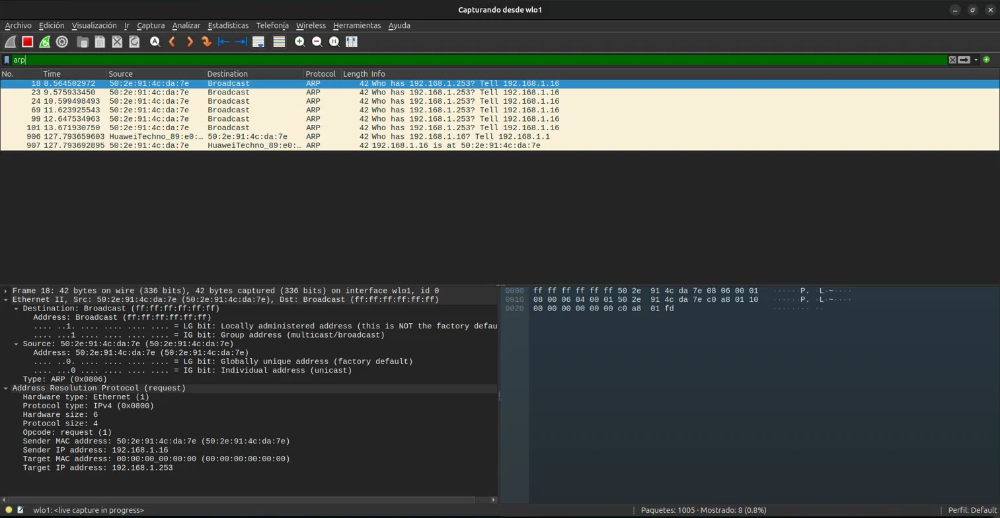

En la captura aparecieron 6 ARP Request (paquetes n.º 18, 23, 24, 69, 99 y 101), todos con el mismo contenido: `Who has 192.168.1.253? Tell 192.168.1.16`, enviados a intervalos crecientes de aproximadamente 1 segundo. No hubo ningún ARP Reply, porque ningún dispositivo de la red respondió: la IP simplemente no está en uso por ningún equipo. Esto se confirma también con el comando `ip neigh show`, donde la entrada para `192.168.1.253` quedó en estado `FAILED`, indicando que la resolución nunca se completó.

```bash
enzo@enzo-HP-255R-15-6-inch-G10-Notebook-PC:~$ ping -4 -n 192.168.1.253
PING 192.168.1.253 (192.168.1.253) 56(84) bytes of data.
From 192.168.1.16 icmp_seq=1 Destination Host Unreachable
From 192.168.1.16 icmp_seq=2 Destination Host Unreachable
From 192.168.1.16 icmp_seq=3 Destination Host Unreachable
^C
--- 192.168.1.253 ping statistics ---
5 packets transmitted, 0 received, +3 errors, 100% packet loss, time 4083ms
pipe 4
enzo@enzo-HP-255R-15-6-inch-G10-Notebook-PC:~$ ip neigh show
192.168.1.253 dev wlo1 FAILED 
192.168.1.1 dev wlo1 lladdr b4:3a:e2:89:e0:cf REACHABLE 
192.168.1.11 dev wlo1 lladdr 58:11:22:4d:7d:d4 STALE 
fe80::1 dev wlo1 lladdr b4:3a:e2:89:e0:cf router STALE 
```

Tampoco apareció ningún paquete ICMP Echo Request en la captura. Esto se explica porque el sistema operativo no puede armar la trama Ethernet del ping sin conocer antes la MAC de destino: al no recibir nunca el ARP Reply, el envío del Echo Request queda bloqueado a nivel de capa de enlace y el paquete ICMP nunca llega a construirse ni transmitirse. De hecho, la propia salida del comando `ping` lo refleja: en lugar de mostrar timeouts (que indicarían que el Echo Request sí se envió pero no hubo respuesta), muestra “Destination Host Unreachable”, generado localmente por el propio sistema operativo al no poder resolver la dirección MAC del destino.

**d)** Al volver a hacer ping al mismo destino (`192.168.1.253`) un momento después, sí volvió a aparecer tráfico ARP: se observó una nueva tanda de 6 ARP Request (paquetes 6627-6647), idéntica en estructura a la primera (mismo patrón de reintentos, sin ningún Reply). Esto contrasta con el comportamiento observado al pinguear el gateway, donde una resolución exitosa se cachea y se reutiliza sin generar tráfico adicional. La diferencia es que, en este caso, la resolución nunca llegó a completarse con éxito, por lo que no existe ninguna entrada MAC válida que el sistema pueda reutilizar: el estado `FAILED` en la caché no funciona como un dato aprovechable, sino simplemente como el registro de que el último intento no obtuvo respuesta. Por eso, cada nuevo intento de comunicación con un destino que no responde dispara una nueva ronda completa de resolución ARP.

Esto deja en evidencia la ventaja real de la caché, solo ahorra tráfico cuando la resolución fue exitosa y hay una MAC válida para reutilizar. Cuando la resolución falla, no hay nada que cachear de forma útil, así que el costo de reintentar se paga en cada comunicación nueva. El riesgo opuesto, el de una entrada exitosa que queda desactualizada (por ejemplo, si un equipo cambia de placa de red), es que el sistema seguiría usando una MAC incorrecta hasta que esa entrada expire por tiempo y se fuerce una nueva resolución.

---

## Ejercicio 3: TCP y UDP "a mano" con ncat

#### 3.a)
Establecer una conexión es que los dos extremos acuerden un estado compartido antes de enviar datos.
Una conexión TCP existe solo en los extremos, como estado guardado por el sistema operativo de cada host. Los cables y los routers solo ven paquetes IP sueltos y no saben que pertenecen a una conexión.

#### 3.b)
Un puerto es un número de 16 bits que indica a qué proceso dentro de un host va dirigido el tráfico. 
El par (IP, puerto) identifica un extremo de comunicación (un socket). Una conexión TCP se identifica por un par de origen y otro de destino, es decir (IP origen, puerto origen, IP destino, puerto destino).

#### 3.c) 
Si un proceso está escuchando en un puerto significa que el proceso reservó ese puerto y le pidió al sistema operativo que acepte conexiones en él. Desde ese momento, el SO responde con SYN-ACK a los SYN que llegan a ese puerto y entrega las conexiones establecidas al proceso. Si nadie escucha, el SO rechaza el intento.

#### Experimento TCP
Se abrieron dos terminales, una para el cliente y otra para el servidor. En el servidor se ejecutó `ncat -v -l 12000` y en el cliente `ncat -v 127.0.0.1 12000`. En Wireshark se filtró con `tcp.port == 12000`.

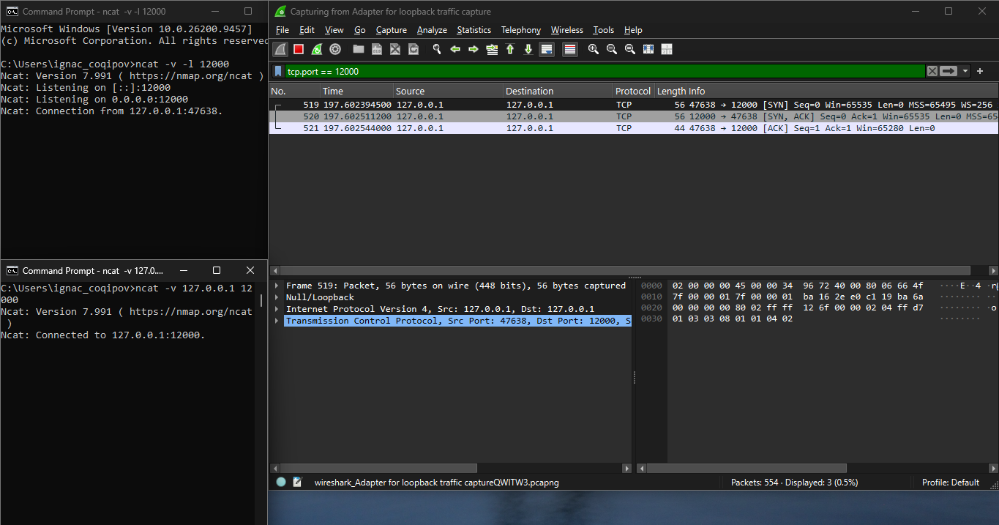

La conexión se establece apenas se ejecuta el cliente, sin escribir nada. Los 3 paquetes que aparecen son:

```
519	cliente (47638) → servidor (12000)	[SYN]
520	servidor → cliente	[SYN, ACK]
521	cliente → servidor	[ACK]
```

Luego se enviaron mensajes desde ambas terminales:

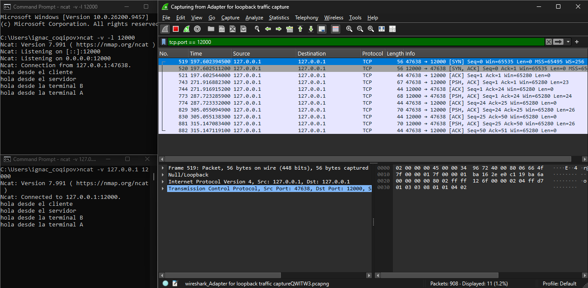

Cada mensaje viaja en un segmento con flags [PSH, ACK] y el otro lado lo confirma con un [ACK] sin datos (Len=0). Por ejemplo, "hola desde el cliente" tiene 21 caracteres pero el segmento muestra Len=23: los 2 bytes extra son el \r\n que agrega Windows al presionar Enter. Los números de ACK acompañan a los datos: después de recibir esos 23 bytes, el servidor responde con Ack=24, es decir, para pedir que le envien desde el byte 24.

Finalmente se cerró el cliente con Ctrl+C:

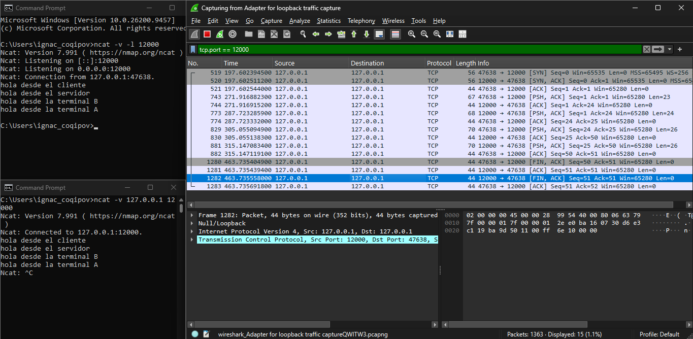

El cliente inicia el cierre con [FIN, ACK], el servidor lo confirma con [ACK] y luego envía su propio [FIN, ACK], que el cliente confirma con [ACK]. Cada lado cierra su dirección por separado, por eso son 4 paquetes.

En total, el intercambio completo usó 15 paquetes: 3 de handshake, 8 de datos y confirmaciones (4 mensajes) y 4 de cierre.

#### Experimento UDP

Se capturó en la interfaz de loopback con el filtro `udp.port == 12001`. Se ejecutó primero el servidor con `ncat -v -u -l 12001` y luego el cliente con `ncat -v -u 127.0.0.1 12001`.

Al ejecutar el cliente, antes de escribir nada, no apareció ningún paquete en la captura. Esto es porque UDP no tiene conexión, el "Connected to 127.0.0.1:12001" que muestra ncat es solo local, el programa deja configurado el destino pero no envía nada hasta que se escribe un mensaje. En TCP, en cambio, ya se habían visto 3 paquetes de handshake en este punto.

Luego se envió un mensaje desde cada terminal:

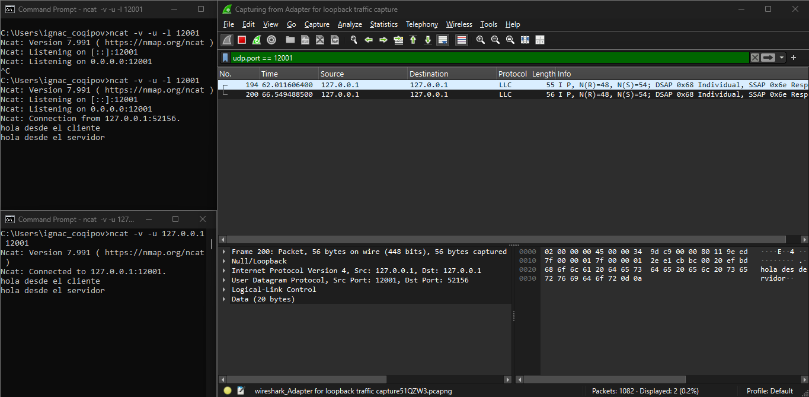


Cada mensaje generó un único datagrama, y no hay ningún paquete que lo confirme. 

```
194  cliente (52156) → servidor (12001)  23 bytes de datos
200  servidor (12001) → cliente (52156)  24 bytes de datos
```

Finalmente se cerró el cliente con Ctrl+C y no apareció ningún paquete nuevo.

#### a) 
En TCP vimos 3 paquetes antes de escribir: [SYN] del cliente, [SYN, ACK] del servidor y [ACK] del cliente, que forman el three-way handshake. En UDP no apareció ningún paquete, porque no tiene conexión.

#### b)
En UDP cada mensaje generó un único datagrama, y no hubo nada parecido a un ACK: cuando el servidor respondió, lo hizo con otro datagrama con datos, no con una confirmación. En TCP cada mensaje generó un segmento [PSH, ACK] con datos, seguido de un [ACK] sin datos del otro lado, así que cada mensaje costó 2 paquetes.

#### c)
El encabezado UDP tiene 4 campos de 2 bytes (puerto origen, puerto destino, longitud y checksum) y ocupa 8 bytes.

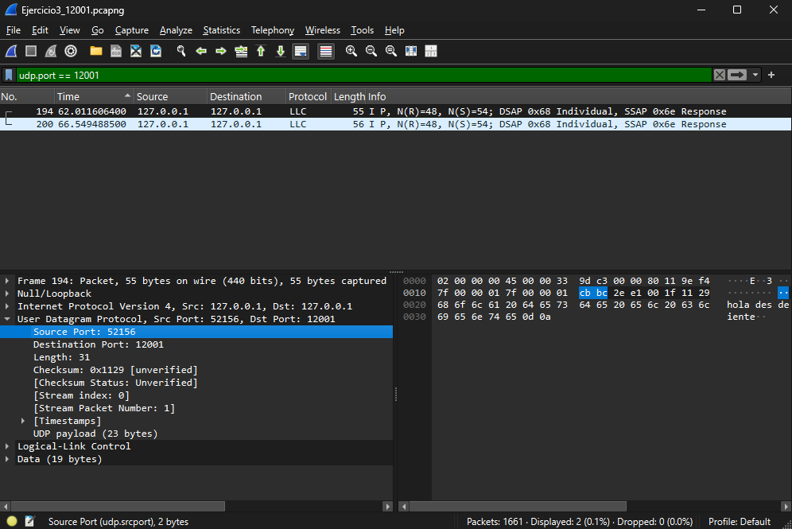

El encabezado TCP tiene puerto origen, puerto destino, número de secuencia, número de ACK, longitud de encabezado, flags, ventana, checksum, puntero urgente y opciones, y ocupa 20 bytes (en un segmento de datos).

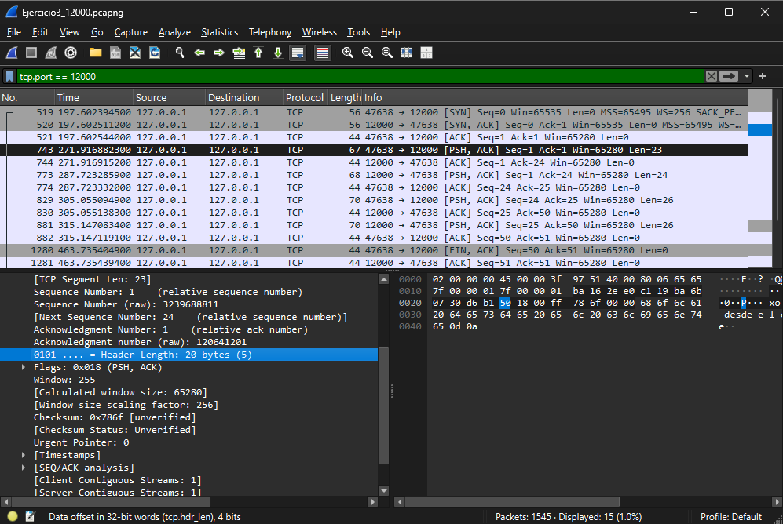

#### d)
Al cerrar el cliente, en TCP hubo 4 paquetes, mientras que en UDP no apareció ningún paquete.

#### e) 
Para enviar un mensaje en un solo sentido, TCP necesitó 9 paquetes (3 de handshake, 1 de datos, 1 de ACK y 4 de cierre) y UDP necesitó 1. En las capturas completas, TCP usó 15 paquetes para 4 mensajes y UDP usó 2 para 2 mensajes. 
Con los paquetes extra, TCP compra entrega confiable, confirmando la recepción, entrega ordenada, control de flujo, etc. UDP no ofrece nada de eso pero es más liviano.

#### f)
En TCP, el cliente manda un [SYN] (paquete 140) y el sistema operativo responde enseguida con un [RST, ACK] (paquete 141). Es una negativa: no hay handshake y ncat avisa que la conexión fue rechazada. Los paquetes siguientes son Windows reintentando el SYN, y cada intento recibe otro RST.

En UDP, el cliente manda el datagrama (paquete 260) y vuelve un ICMP `Destination unreachable (Port unreachable)` (paquete 261). ncat lo muestra como "An existing connection was forcibly closed by the remote host".

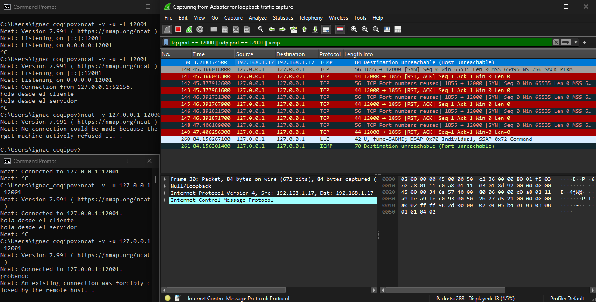

---

## Ejercicio 4: Servidor TCP mínimo con sockets

#### 4.a)
En el servidor, `socket()`, `bind()` y `listen()` son operaciones locales: crean el socket, lo asocian a `127.0.0.1:12000` y dejan el puerto escuchando. No mandan nada por la red.
`accept()` espera a que se conecte un cliente y devuelve un socket nuevo para esa conexión. Con ese socket recibe el mensaje con `recv()`, responde con `sendall()` y sigue leyendo hasta que el cliente cierra (cuando `recv()` devuelve vacío). Al final cierra los dos sockets.

#### 4.b)
El cliente crea su socket y con `connect()` se conecta al servidor, ahí el sistema operativo hace el three-way handshake. El puerto del cliente lo elige el sistema operativo y el script lo muestra con `getsockname()`. Después envía el mensaje con `sendall()`, recibe la respuesta con `recv()` y cierra con `close()`, que manda el FIN.
Si nadie escucha en el puerto, `connect()` falla por el RST (como en el 3.f), y si no hay respuesta corta por timeout a los 5 segundos.

#### 4.c)
Capturamos en loopback con el filtro `tcp.port == 12000` y ejecutamos el servidor y el cliente en dos terminales:

```bash
python tcp_server.py
python tcp_client.py 127.0.0.1 "Hola desde mi programa"
```

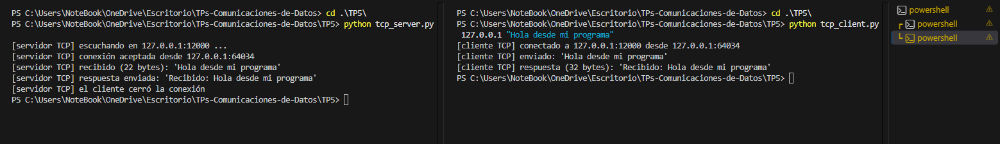

Al cliente le tocó el puerto 64034. El servidor recibió 22 bytes y respondió con 32.

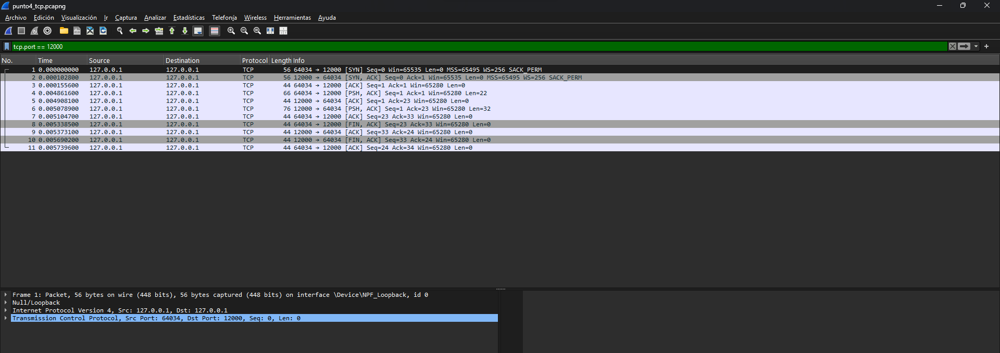

```
1	cliente (64034) → servidor (12000)	[SYN]
2	servidor → cliente	[SYN, ACK]
3	cliente → servidor	[ACK]
4	cliente → servidor	[PSH, ACK]	Len=22
5	servidor → cliente	[ACK]
6	servidor → cliente	[PSH, ACK]	Len=32
7	cliente → servidor	[ACK]
8	cliente → servidor	[FIN, ACK]
9	servidor → cliente	[ACK]
10	servidor → cliente	[FIN, ACK]
11	cliente → servidor	[ACK]
```

Son 11 paquetes: 3 de handshake, 4 de datos con sus ACK y 4 de cierre. El mensaje tiene Len=22, justo los caracteres del texto, porque el script no agrega el \r\n del Enter como pasaba con ncat. La respuesta tiene 32 bytes porque el servidor le suma "Recibido: " adelante.
Al ser loopback, Wireshark muestra un encabezado Null/Loopback en lugar de Ethernet II, por eso los ACK miden 44 bytes (4 de loopback, 20 de IP y 20 de TCP).

#### 4.d)

| Llamada | ¿Dónde se ejecuta? | ¿Genera tráfico? | Segmentos que observamos |
|---|---|---|---|
| `socket()` | servidor y cliente | No | - |
| `bind()` | servidor | No | - |
| `listen()` | servidor | No | - |
| `connect()` | cliente | Sí | 1 `[SYN]`, 2 `[SYN, ACK]` y 3 `[ACK]` |
| `accept()` | servidor | No | - (la conexión ya estaba hecha en el paquete 3) |
| `sendall()` | servidor | Sí | 6 `[PSH, ACK]` con 32 bytes y 7 `[ACK]` |
| `recv()` | servidor | No | - (los datos ya habían llegado en el paquete 4) |
| `close()` | ambos | Sí | 8 `[FIN, ACK]`, 9 `[ACK]`, 10 `[FIN, ACK]` y 11 `[ACK]` |

El `sendall()` del cliente no está en la tabla, pero es el que genera el paquete 4 (22 bytes) y su ACK, el 5.
Solo `connect()`, `sendall()` y `close()` generan tráfico. El handshake y los ACK los maneja el sistema operativo, por eso `accept()` y `recv()` no mandan nada: solo le entregan al programa lo que ya llegó.

---
